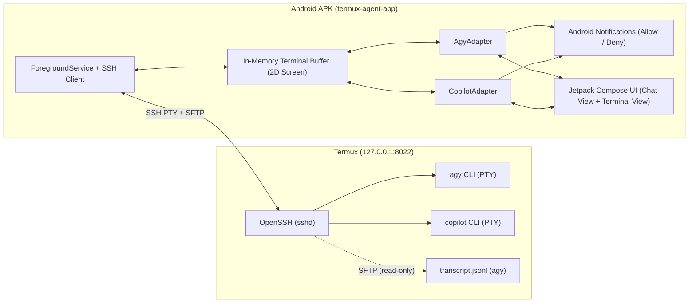
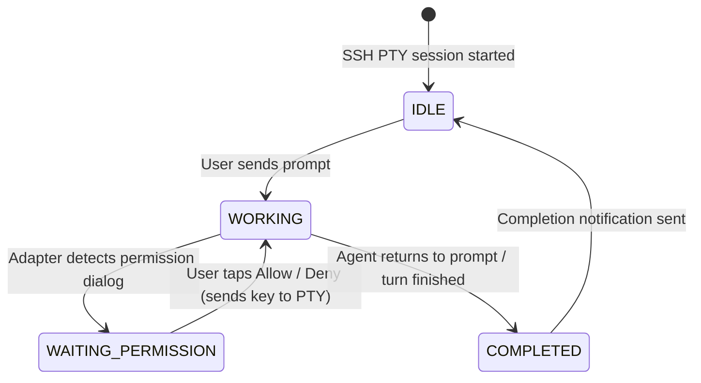

# termux-agent-app

Native Android application (APK) providing a **visual interface (Chat + Terminal)** and **interactive background notifications** for CLI AI agents running inside **Termux** (**Google Antigravity CLI `agy`** and **GitHub Copilot CLI `copilot`**), connecting over **standard `sshd`** without modifying either agent.

---

## Purpose

Running AI agents directly in Termux is powerful, but using TUI interfaces from a mobile touchscreen has two major limitations:
1. **No background alerts:** if you switch apps or lock your phone while the agent is working, you have no way to know when it pauses to ask permission to run a command or when it finishes its task.
2. **Visual friction:** reading long Markdown responses or answering quick confirmations (`Allow` / `Deny`) inside a full-screen TUI is awkward on small displays.

**`termux-agent-app`** solves both issues by acting as a native visual client built around **Adapters inside the APK itself**:
- **Zero modifications to the agents:** never patches or alters the installation or configuration files of `agy` or `copilot`.
- **Zero custom daemons in Termux:** uses Termux's standard OpenSSH server (`sshd` on `127.0.0.1:8022`) to open interactive PTY channels and SFTP access.
- **Actionable notifications:** a `ForegroundService` keeps the session alive and posts native Android notifications whenever an agent requests permission (**Allow / Deny** right from the notification, without opening the app) or completes a turn.

---

## Base Termux Projects

This application is designed to work on top of the native Termux (Android/aarch64) adaptations of both agents:

- **GitHub Copilot CLI on Termux:** [cafeteru/copilot-termux](https://github.com/cafeteru/copilot-termux) — Native execution of `@github/copilot-linux-arm64` on Termux via `glibc-runner` without PRoot.
- **Google Antigravity CLI (`agy`) on Termux:** [wallentx/antigravity-cli-termux](https://github.com/wallentx/antigravity-cli-termux) — Native adaptation of Antigravity CLI (`agy`) for Android/Termux.

---

## Architecture

### Component Overview



### Adapter State Machine

Each `AgentAdapter` inside the APK translates the 2D virtual PTY screen state into a unified state flow:



---

## How Adapters Work (Inside the APK)

Both `agy` and `copilot` are TUI applications that redraw the terminal using ANSI escape sequences. Rather than parsing raw `stdout` line by line, the APK feeds the PTY stream into an **in-memory terminal buffer** (2D) and delegates interpretation to an agent-specific adapter:

| Adapter | PTY Launch | Chat Message Reading | Permission Detection & Response |
|---|---|---|---|
| **`AgyAdapter`** | Launches `agy` in the selected workspace | Combines the 2D virtual screen with read-only SFTP reading of `~/.gemini/antigravity-cli/brain/<id>/.system_generated/logs/transcript.jsonl` | Detects the tool confirmation box in the 2D buffer, extracts the command, and sends the approval/rejection key to the PTY |
| **`CopilotAdapter`** | Launches `copilot` in the selected workspace | Extracts response blocks from the 2D screen buffer | Detects Copilot's execution/tool confirmation prompt and sends the corresponding keystroke to the PTY |

Adding support for another CLI agent in the future (e.g., Claude Code or Gemini CLI) only requires implementing a new `AgentAdapter` class in Kotlin inside the APK.

---

## Termux Prerequisites

1. Have at least one of the agents installed:
   - [cafeteru/copilot-termux](https://github.com/cafeteru/copilot-termux) (`copilot`)
   - [wallentx/antigravity-cli-termux](https://github.com/wallentx/antigravity-cli-termux) (`agy`)
2. Install and start OpenSSH in Termux:
   ```bash
   pkg install -y openssh
   passwd          # Or configure a public key in ~/.ssh/authorized_keys
   sshd            # Listens on port 8022 by default
   ```

---

## Roadmap

- [x] **Phase 1 — Android Base & SSH Connection:** Kotlin/Jetpack Compose project setup, persistent `ForegroundService`, and SSH connection (`127.0.0.1:8022`) with PTY support.
- [x] **Phase 2 — Adapter Engine & 2D Terminal:** In-memory terminal buffer integration, `AgentAdapter` interface, `AgyAdapter`, and `CopilotAdapter`.
- [x] **Phase 3 — Interactive Notifications:** High-priority notification channel with `PendingIntent` actions for **Allow** / **Deny** buttons and task-completion alerts.
- [ ] **Phase 4 — Dual Interface (Chat + Terminal):** Clean Chat tab with Markdown rendering and agent selector (`agy` / `copilot`) + direct Terminal tab for manual inspection.
