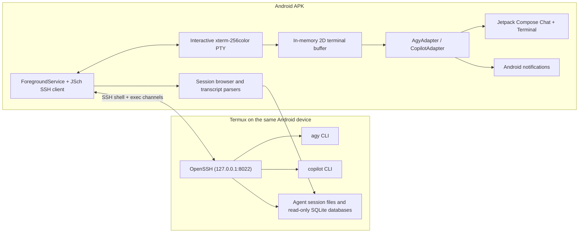
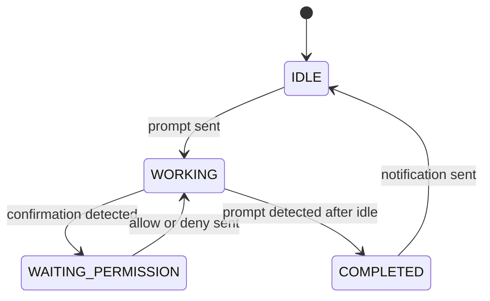

# termux-agent-app

Native Android client for running CLI AI agents inside Termux from a touch-friendly
**Chat + Terminal** interface. The app supports **Google Antigravity CLI (`agy`)**
and **GitHub Copilot CLI (`copilot`)**.

The APK connects to Termux through its standard OpenSSH server. It does not patch
either CLI, install a Termux daemon, or require a bridge outside the Android app.

The agent integration follows a hexagonal boundary: Android UI, services, and SSH
transport consume the `AgentAdapter` port. `AgyAdapter` and `CopilotAdapter` are
strategies that own agent-specific launch, session discovery, transcript parsing,
screen detection, prompt delivery, and permission resolution. The orchestration
layer does not branch on agent IDs.

## Features

- Persistent SSH PTY connection to `127.0.0.1:8022` through an Android
  `ForegroundService`.
- Password and generated SSH public-key authentication.
- Agent selector for `agy` and `copilot`.
- Workspace browser that launches the selected agent in a project directory.
- Native Chat view with Markdown, tool-call details, and permission cards.
- Native Terminal view for direct commands and raw keys such as `Ctrl`, `Alt`,
  `Tab`, arrows, and `Esc`.
- Session management grouped by workspace, including new sessions and
  resuming saved `agy` or `copilot` conversations.
- Chat restoration from each CLI's local transcript or session store.
- High-priority notifications for permission requests and completed turns.
- Direct **Allow** / **Deny** notification actions.
- `AgyAdapter` support for permission menus with multiple options in the in-app
  Chat view.

## Requirements

Termux must provide:

1. At least one supported agent:
   - [GitHub Copilot CLI on Termux](https://github.com/cafeteru/copilot-termux)
   - [Google Antigravity CLI on Termux](https://github.com/wallentx/antigravity-cli-termux)
2. OpenSSH:

   ```bash
   pkg install -y openssh
   passwd
   sshd
   ```

`sshd` listens on port `8022` by default. Leave Termux running while the Android
app connects.

Python 3 is optional but recommended in Termux. When available, session
discovery and chat restoration read the agents' SQLite databases read-only and
fall back to their JSONL state files when needed.

## First Connection

1. Install the app and open **Configuration**.
2. Choose password or SSH-key authentication.
3. Use the default user `termux`, host `127.0.0.1`, and port `8022` unless your
   OpenSSH setup differs.
4. For key authentication, copy the generated setup command from the app and
   run it in Termux.
5. Save and connect.
6. Select a workspace, choose `agy` or `copilot`, then launch the agent.

The app stores its SSH configuration in private Android preferences. App backup
is disabled; reinstalling the app creates a new generated SSH key.

## Architecture



### Adapter Flow

Raw PTY output is rendered into an in-memory 2D terminal buffer. Each
`AgentAdapter` inspects the rendered screen and emits one of these states:



The core adapter API lives in the APK:

```kotlin
interface AgentAdapter {
    val id: String
    val name: String
    val currentState: AgentState

    fun launchCommand(workspacePath: String = ""): String
    fun launchConversationCommand(
        workspacePath: String = "",
        conversationId: String? = null
    ): String
    fun onScreenUpdated(screenLines: List<String>, idleMs: Long): AdapterEvent?
    fun sendPrompt(ptyOutput: OutputStream, text: String)
    fun resolvePermission(
        ptyOutput: OutputStream,
        allow: Boolean,
        optionIndex: Int? = null
    )
    fun markCompleted()
    fun reset()
}
```

Adapter-specific launch and resume behavior:

| Adapter | New session | Resume session | Chat source |
|---|---|---|---|
| `AgyAdapter` | `agy` | `agy --conversation <id>` | `~/.gemini/antigravity-cli/.../transcript.jsonl` |
| `CopilotAdapter` | `copilot` | `copilot --resume=<id>` | `~/.copilot/session-state/.../events.jsonl` or `~/.copilot/session-store.db` |

Session listing, transcript reads, and workspace browsing use short-lived SSH
`exec` channels. The interactive agent itself uses one persistent PTY shell.

## Project Layout

```text
app/src/main/java/com/termux/agent/
├── domain/model/             Framework-free agent models and events
├── application/
│   ├── config/               App-wide constants
│   └── port/                 AgentAdapter port
├── infrastructure/
│   ├── agent/                Agy/Copilot strategies and transcript parsers
│   ├── ssh/                  SSH PTY, sessions, and workspace discovery
│   ├── terminal/             ANSI-aware terminal rendering
│   └── android/              Foreground service and notifications
└── presentation/             Jetpack Compose UI and Android entry point
```

Dependency direction is `presentation -> application/infrastructure -> domain`.
Agent-specific branches stay in infrastructure strategies; SSH orchestration,
Android lifecycle, and UI consume the shared `AgentAdapter` port.

## Build

Requirements:

- JDK 17
- Android SDK platform 35
- Gradle 8.11.1 or another version compatible with Android Gradle Plugin 8.7.3

Create `local.properties` with the local Android SDK path:

```properties
sdk.dir=/path/to/Android/Sdk
```

Then run the fast unit suite:

```bash
gradle testDebugUnitTest assembleDebug --no-daemon
```

Run the slower SSH/Compose E2E suite separately:

```bash
gradle testDebugE2E --no-daemon
```

Use `gradle testDebugAll assembleDebug --no-daemon` for full local verification.

The APK is written to:

```text
app/build/outputs/apk/debug/app-debug.apk
```

On Termux, the project uses the locally installed Android SDK and ARM64 `aapt2`.
The host-specific paths belong in git-ignored `local.properties` and user-level
`~/.gradle/gradle.properties`.

See [docs/termux-development.md](docs/termux-development.md) for the maintainer's
Termux toolchain and on-device APK workflow.

## Tests

The test suite covers:

- ANSI terminal buffering and screen updates.
- Adapter permission and completion detection.
- `agy` and `copilot` transcript parsing.
- Session discovery and workspace grouping.
- SSH integration with a local test server.
- Jetpack Compose UI and notification behavior with Robolectric.
- End-to-end connection, Chat, and Terminal workflows.

Run the fast unit tests with:

```bash
gradle testDebugUnitTest --no-daemon
```

Run slower SSH/Compose/Robolectric E2E tests separately:

```bash
gradle testDebugE2E --no-daemon
```

Run both suites for full local verification:

```bash
gradle testDebugAll --no-daemon
```

Tests run on any supported development host. Termux-specific shell contract tests
use `HostTestSupport` to verify the required `sh`, `python3`, `HOME`, and symlink
capabilities, then skip with an explicit reason when that runtime is unavailable.
Core JVM parsing and application tests still run on every host.

GitHub Actions runs the unit and UI test suite on pull requests and pushes to
`main`. Successful pushes to `main` also build and upload `app-debug.apk`.

## Scope

This project treats both CLIs as external interactive processes. Their binaries,
installation directories, configuration, and lifecycle are not modified by the
app.

The Android service owns the SSH client and adapter integration. Termux only
needs OpenSSH and the supported CLIs; no custom daemon or package-specific agent
hook is installed.
