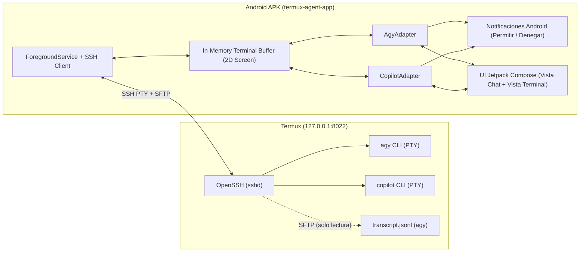
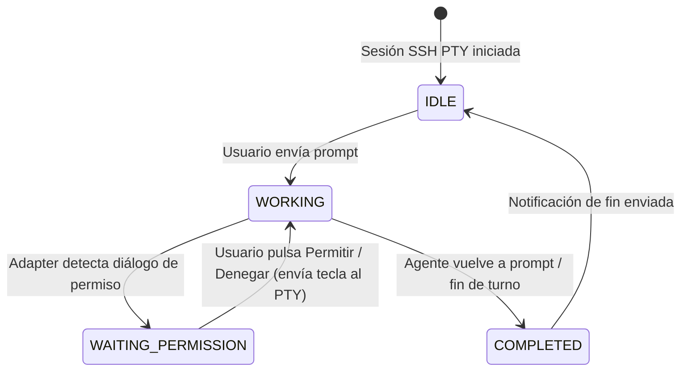

# termux-agent-app

Aplicación nativa Android (APK) que proporciona una **interfaz visual (Chat + Terminal)** y **notificaciones interactivas en segundo plano** para agentes de IA de consola ejecutándose en **Termux** (**Google Antigravity CLI `agy`** y **GitHub Copilot CLI `copilot`**), conectándose mediante **`sshd` estándar** sin modificar ninguno de los agentes.

---

## Propósito

Ejecutar agentes de IA directamente en Termux es potente, pero usar interfaces TUI desde la pantalla táctil del móvil tiene dos grandes limitaciones:
1. **Sin avisos en segundo plano:** si cambias de app o bloqueas el móvil mientras el agente trabaja, no te enteras de cuándo se detiene a pedir permiso para ejecutar un comando ni de cuándo ha terminado su tarea.
2. **Fricción visual:** leer respuestas largas en Markdown o responder confirmaciones rápidas (`Allow` / `Deny`) en una TUI completa resulta incómodo en pantallas pequeñas.

**`termux-agent-app`** resuelve ambos problemas actuando como un cliente visual nativo con un diseño basado en **Adapters dentro de la propia APK**:
- **Cero modificaciones en los agentes:** no parchea ni altera la instalación ni los ficheros de configuración de `agy` ni de `copilot`.
- **Cero demonios propios en Termux:** utiliza el servidor OpenSSH estándar de Termux (`sshd` en `127.0.0.1:8022`) para abrir canales PTY interactivos y lectura SFTP.
- **Notificaciones con botones de acción:** un `ForegroundService` mantiene la sesión viva y lanza notificaciones nativas de Android cuando el agente solicita permisos (**Permitir / Denegar** desde la propia notificación, sin abrir la app) o cuando finaliza un turno.

---

## Proyectos Base en Termux

Esta aplicación está diseñada para trabajar sobre las adaptaciones nativas de ambos agentes para Termux (Android/aarch64):

- **GitHub Copilot CLI en Termux:** [cafeteru/copilot-termux](https://github.com/cafeteru/copilot-termux) — Ejecución nativa de `@github/copilot-linux-arm64` en Termux mediante `glibc-runner` sin PRoot.
- **Google Antigravity CLI (`agy`) en Termux:** [wallentx/antigravity-cli-termux](https://github.com/wallentx/antigravity-cli-termux) — Adaptación nativa de Antigravity CLI (`agy`) para Android/Termux.

---

## Arquitectura

### Vista General de Componentes



### Máquina de Estados de los Adapters

Cada `AgentAdapter` dentro de la APK traduce el estado de la pantalla virtual 2D del PTY a un flujo de estados unificado:



---

## Cómo funcionan los Adapters (dentro de la APK)

Tanto `agy` como `copilot` son aplicaciones TUI que redibujan la terminal mediante secuencias ANSI. En lugar de parsear `stdout` crudo línea a línea, la APK procesa el flujo PTY a través de un **buffer de terminal en memoria** (2D) y delega la interpretación en un adapter específico por agente:

| Adapter | Arranque en PTY | Lectura de mensajes para el Chat | Detección y respuesta de permisos |
|---|---|---|---|
| **`AgyAdapter`** | Lanza `agy` en el workspace seleccionado | Combina la pantalla virtual 2D con la lectura en solo-lectura de `~/.gemini/antigravity-cli/brain/<id>/.system_generated/logs/transcript.jsonl` vía SFTP | Detecta el cuadro de confirmación de herramientas en el buffer 2D, extrae el comando y envía la tecla de aprobación/rechazo al PTY |
| **`CopilotAdapter`** | Lanza `copilot` en el workspace seleccionado | Extrae los bloques de respuesta desde el buffer de pantalla 2D | Detecta el prompt de confirmación de ejecución/herramienta de Copilot y envía la pulsación correspondiente al PTY |

Añadir soporte para otro agente de consola en el futuro (p. ej. Claude Code o Gemini CLI) solo requiere implementar una nueva clase `AgentAdapter` en Kotlin dentro de la APK.

---

## Requisitos en Termux

1. Tener instalado al menos uno de los agentes:
   - [cafeteru/copilot-termux](https://github.com/cafeteru/copilot-termux) (`copilot`)
   - [wallentx/antigravity-cli-termux](https://github.com/wallentx/antigravity-cli-termux) (`agy`)
2. Instalar y arrancar OpenSSH en Termux:
   ```bash
   pkg install -y openssh
   passwd          # O configurar clave pública en ~/.ssh/authorized_keys
   sshd            # Escucha por defecto en el puerto 8022
   ```

---

## Hoja de Ruta (Roadmap)

- [ ] **Fase 1 — Base Android & Conexión SSH:** Estructura del proyecto Kotlin/Jetpack Compose, `ForegroundService` persistente y conexión SSH (`127.0.0.1:8022`) con soporte PTY.
- [ ] **Fase 2 — Motor de Adapters y Terminal 2D:** Integración de buffer de terminal en memoria, interfaz `AgentAdapter`, `AgyAdapter` y `CopilotAdapter`.
- [ ] **Fase 3 — Notificaciones Interactivas:** Canal de notificaciones de alta prioridad con `PendingIntent` para botones **Permitir** / **Denegar** y aviso de fin de tarea.
- [ ] **Fase 4 — Interfaz Dual (Chat + Terminal):** Pestaña de Chat limpio con Markdown y selector de agente (`agy` / `copilot`) + pestaña de Terminal directa para inspección manual.
